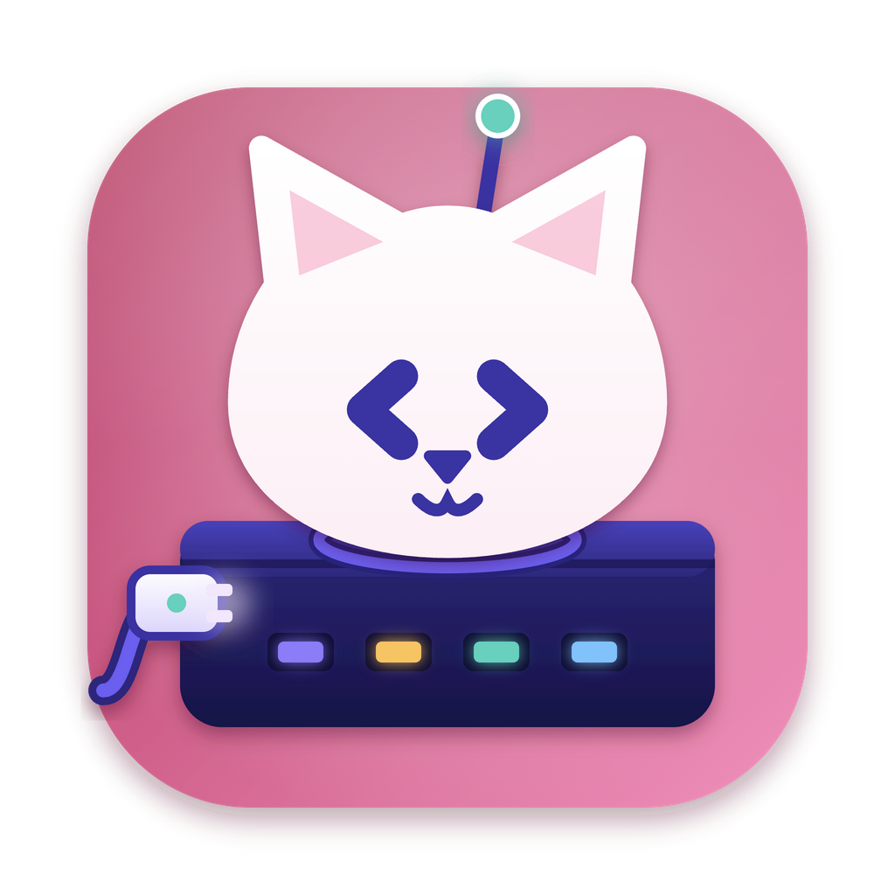

<p align="center"></p>

<h1 align="center">MCatzP</h1>

<p align="center">One MCP server for every Catzoid app — DevCatz, DBCatz, DialCatz and DoCatz.<br>
<em>The MCP with the cats inside. One connection, every cat. You hold the keys.</em></p>

<p align="center"><a href="https://catzoid.com/mcatzp">catzoid.com/mcatzp</a></p>

> Works with DevCatz, DBCatz, DialCatz and DoCatz **1.1.0 or later**; an older app tells you to update it.

## Install

Settings → MCatzP in any of the four apps installs it and adds it to your AI client. Or:

```bash
brew install catzoidhub/catz/mcatzp
```

```bash
claude mcp add mcatzp -- npx -y mcatzp
```

Binaries for macOS (Apple silicon, Intel; signed and notarized), Windows (x64, not signed) and Linux (x64, arm64;
glibc, not signed) are on
[catzoid.com/mcatzp](https://catzoid.com/mcatzp).

MCatzP lets an AI assistant — Claude Code, ZCode, Claude Desktop, Cursor, Gemini CLI, Codex CLI or any client that
speaks MCP — use the Catzoid apps on your computer. It runs locally over stdio; each app decides what it shares, and
every change is confirmed in the app, not in the chat.

## Uninstall

Uninstalling a Catzoid app leaves MCatzP alone. First take it out of your clients, with **Remove** under Settings →
MCatzP in any of the apps, or by hand (for Claude Code: `claude mcp remove mcatzp`). Then remove the program the way it
came:

```bash
# Homebrew
brew uninstall mcatzp

# installed from an app, or moved there from the zip (macOS)
rm -f "$HOME/.catzoid/bin/mcatzp"
```

```powershell
# installed from an app, or moved there from the zip (Windows)
Remove-Item -Force "$env:LOCALAPPDATA\Catzoid\bin\mcatzp.exe"
```

With `npx` there is nothing installed to remove. Every client's file:
[catzoid.com/docs/mcatzp#uninstall](https://catzoid.com/docs/mcatzp#uninstall).

## How it works

MCatzP finds the installed apps through their `bridge.json`, connects to a local channel each app opens only while
its MCatzP switch is on, and offers the app's actions as tools (`dbcatz_list_tables`, `devcatz_start_site` …). Read
actions run at once inside what you shared; changes ask in the app; destructive actions make you type the name. See
[docs/protocol.md](docs/protocol.md).

## Repository

| Package | What |
| --- | --- |
| `packages/server` | `mcatzp`, the MCP server (npm and a single binary per platform) |
| `packages/host` | `@catzoid/mcatzp-host`, what the apps embed: channel, token, pairing, tiers, log |
| `packages/protocol` | `@catzoid/mcatzp-protocol`, the shared types |
| `packages/fakecat` | a stand-in app for testing |

```bash
bun install
bun test
bun run typecheck
bun run build
```

## Licence

MCatzP is free software under the Apache License 2.0. It comes with no warranty. See [`LICENSE`](LICENSE) and
[`NOTICE`](NOTICE).

The names Catzoid and MCatzP and the Catzoid cat are trademarks and are **not** covered by the licence: a fork must
use its own name and icon. See [`TRADEMARKS.md`](TRADEMARKS.md).

Contributions are welcome — see [`CONTRIBUTING.md`](CONTRIBUTING.md). Before your first pull request is merged you
sign the [contributor licence agreement](CLA.md) through the CLA check on the pull request — you keep the copyright of
your work. Questions and bug reports: [`SUPPORT.md`](SUPPORT.md); security problems, privately: [`SECURITY.md`](SECURITY.md).

Copyright © 2026 Mahryan Rakhmatullah
